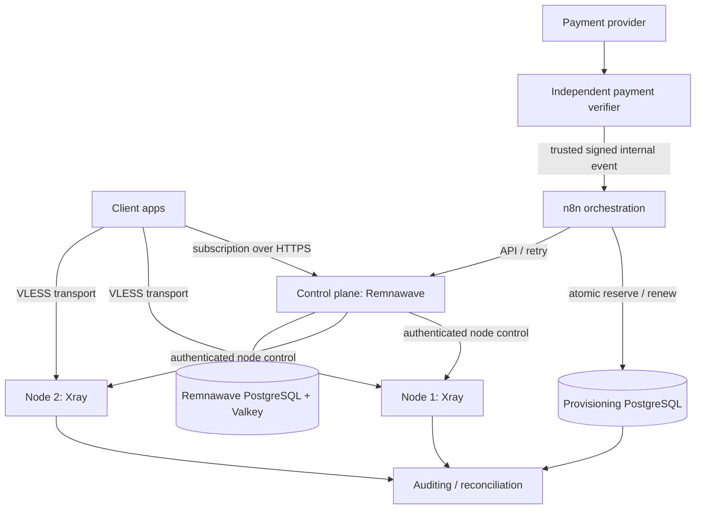

# Architecture — V2Ray-500 / pre-deployment

## Goals

- Up to **500 active entitled subscriptions**; concurrent sessions **not guaranteed**.
- Phased user intake: **50 → 200 → 500**.
- Estimated total data: **15 TB/month** (planning only: 30 GB/user/month).
- Maximum monthly **infrastructure** cost: **15,000,000 toman**; verify exchange rates, egress, taxes and plan stock before purchase.
- Minimize blast radius: **company/SFIORD production is NOT a deployment target**.

## Trust boundaries and data flow

**Database boundary:** `provisioning` is a **separate** database/schema owned by the billing integration. Do not apply our SQL migration to Remnawave's internal database. Remnawave is the source of truth for actual remote enablement; provisioning records must be reconciled with it.

## Logical servers

| VPS | Services | Public inbound | Restricted inbound |
|---|---|---|---|
| control-01 | Remnawave backend, PostgreSQL, Valkey, optional n8n and reverse proxy | 443/TCP for required HTTPS endpoints | SSH from operator network only; 3000/3001/5432 internal |
| node-01 | Remnawave Node, Xray, reverse proxy as designed | designated Xray transport TCP/UDP only | authenticated management channel, SSH allowlisted |
| node-02 | identical to node-01 | designated transport only | authenticated management channel, SSH allowlisted |

**Avoid conflating** Node management port and public VLESS inbound port. Exact ports, certificates and TLS/SNI settings must be selected from a tested Remnawave profile and official documentation.

### Why two nodes
- Two distinct public endpoints let clients choose another route if one fails.
- Two nodes on one provider do not solve provider-wide blocking or outages; independent regions/providers may be needed.
- Client-side automatic failover is app-dependent; validate on target Android/iOS/Windows clients.

## Capacity / seat management

The real limit is enforced in PostgreSQL function `provisioning.reserve()` using a transaction advisory lock. Every `reserved`, `provisioning`, `active`, and `deactivating` state consumes a seat; a seat is only freed when remote deactivation is independently confirmed and state becomes `released`.

- Initial staged limit: 50, later 200, absolute maximum 500 (DB constraint).
- Concurrent attempts serialize and cannot allocate 501 seats if app role has no direct table DML.
- Renewals are not counted as new subscriptions.
- Failed payments must never produce a reservation.
- Paid orders declined at capacity require a refund/waitlist flow and human notification.

This SQL is **one building block**. Before go-live, implement auditable capacity-gate authorization and reconciliation with Remnawave to prevent drift.

## Reliability goals (must be proven before increasing stage)

- 50 users: full provisioning, connection success and usable client configs.
- 200 users: p95 latency, node throughput, CPU steal and per-node traffic quotas.
- 500 users: successful load test, backups, alerting, billing reconciliation and monthly cost forecast remain within limit.
- Any failed real-world canary pauses onboarding; do not auto-grow without manual go/no-go approval.

## Known blockers

VPSs, real domain names, validated Xray config, payment gateway choice, admin SSH credentials (never in Git), actual abuse policy, real-client tests, backup target and release pinning.
