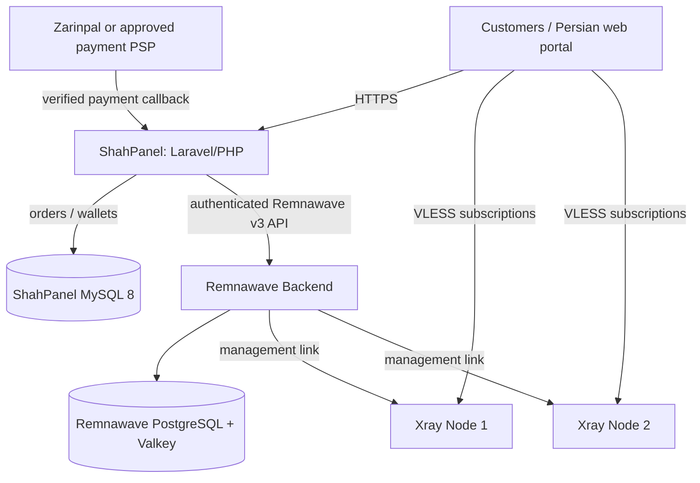

# Architecture — ShahPanel primary / Remnawave / Xray

**Status: planned only. Binding decision [ADR-003](ADR-003-shahpanel-selection.md).**

## Production topology (three proposed VPS)

**Single commerce owner:** ShahPanel MySQL. Remnawave maintains actual remote VPN user/subscription status. No separate Minishop, n8n billing system or our experimental PostgreSQL `provisioning` schema in production.

| Server | Proposed service | Notes |
|---|---|---|
| control-01 | ShahPanel + its MySQL, plus isolated Remnawave Backend + its PostgreSQL/Valkey | Feasible only **after** measured CPU/RAM/storage contention, secure TLS/isolation/backups |
| node-01 | Remnawave Node + Xray | Customer traffic; independent remote IP |
| node-02 | Remnawave Node + Xray | Customer traffic; test real failover and provider outage |

ShahPanel and Remnawave should not share a database. Backend/admin/DB and node management ports must not be exposed openly; use least privilege, allowlists/private links, strong credentials, encrypted backups and monitoring.

## Capacity and cost

- Hard limit: **500 active paid entitlements**, stage **50 → 200 → 500**.
- Planning: 30GB/month × 500 = **15TB/month** total; simultaneous activity unknown.
- Infrastructure ceiling **15,000,000 toman/month**; no live price/capacity guarantee.
- ShahPanel is PHP/MySQL; Remnawave requires its own runtime/DB; do not apply the unrelated Postgres proof to either database.
- **Required implementation gate:** inspect ShahPanel for native global active-entitlement caps. If absent, patch its existing MySQL purchase/provisioning transaction atomically. Prevent paid-but-unfulfilled orders and duplicate callbacks. Only release a seat after remote user is disabled.

## Operational/business flow

1. Customer chooses Persian package in ShahPanel portal.
2. ShahPanel starts domestic PSP transaction; **confirms with provider server-side**, not browser claims.
3. Existing ShahPanel sale/account transaction checks global capacity and reserve/fulfillment.
4. ShahPanel calls authenticated Remnawave API to create or update one remote user with proper Internal Squad.
5. Subscription link served to customer, expiry/renewal tracked by ShahPanel; background sync/reconciliation with Remnawave must be proven.
6. Refund, timeout or remote failure: do not duplicate entitlement; audit and reconcile before confirming delivery.

No part of this flow has been run in our own environment yet.

## Security and go/no-go

- Review AGPL-3.0-or-later obligations, ShahPanel root installer, update scripts, payment and auth handling.
- Validate Persian RTL on mobile and desktop and exact rial/toman conversions.
- Verify real Remnawave 3.x API creation/renewal/suspension and node status with isolated test data.
- Check automated backups *and restore* for both databases, node-offline alerts and private key isolation.
- Ramp 50 → 200 → 500 only after load test, latency and costs stay within limits.

Refer to [staging runbook](shahpanel-staging-runbook.md) for steps.
